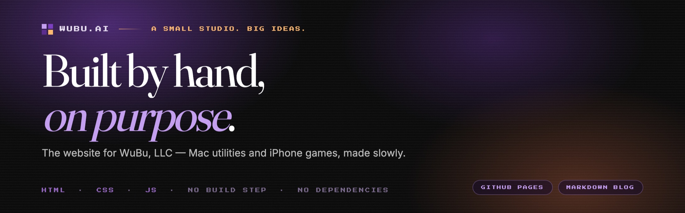
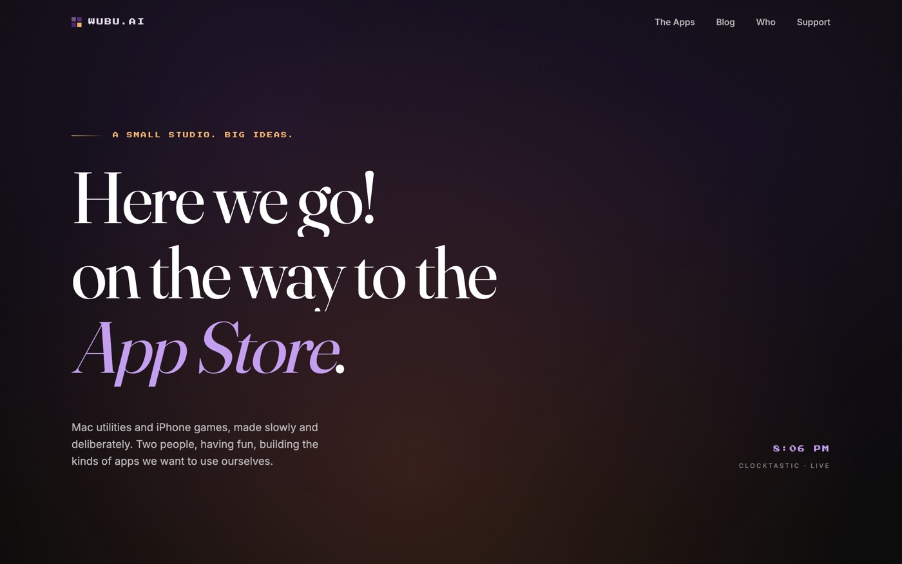
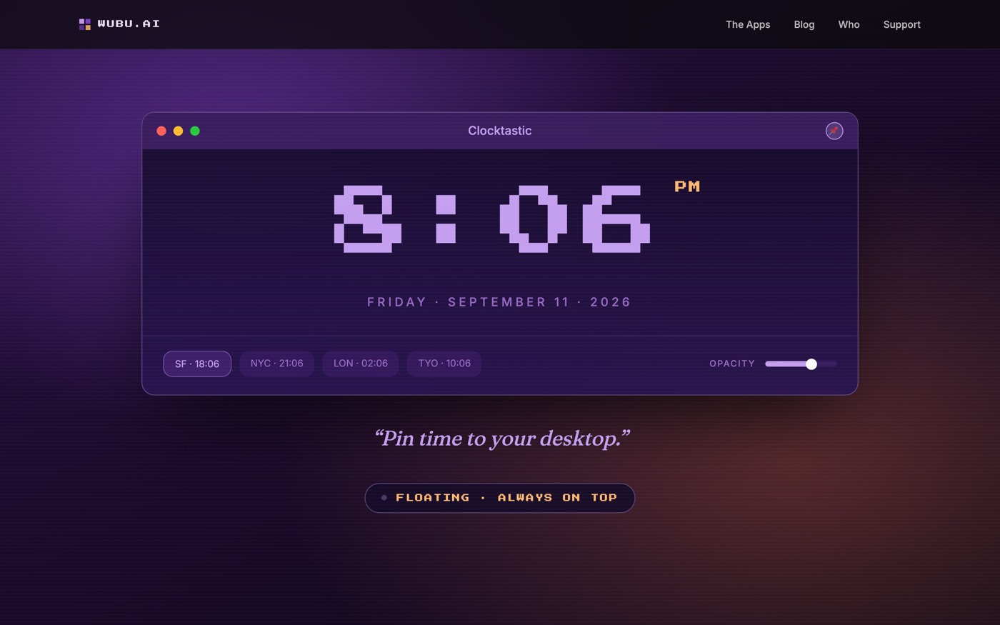
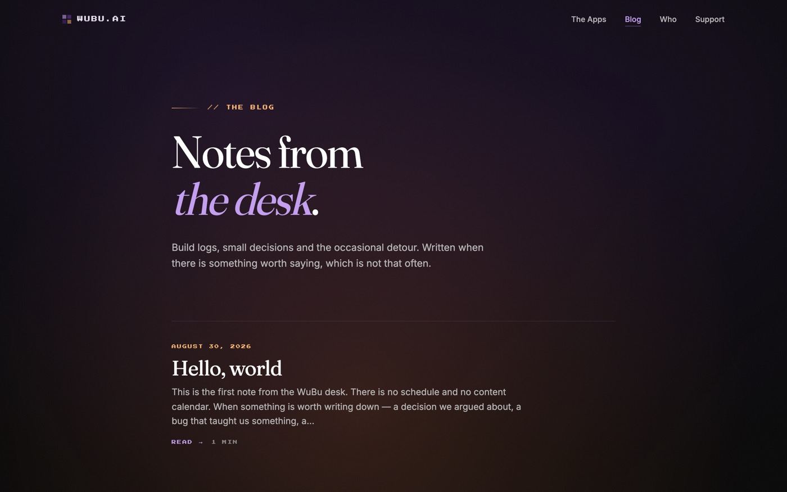
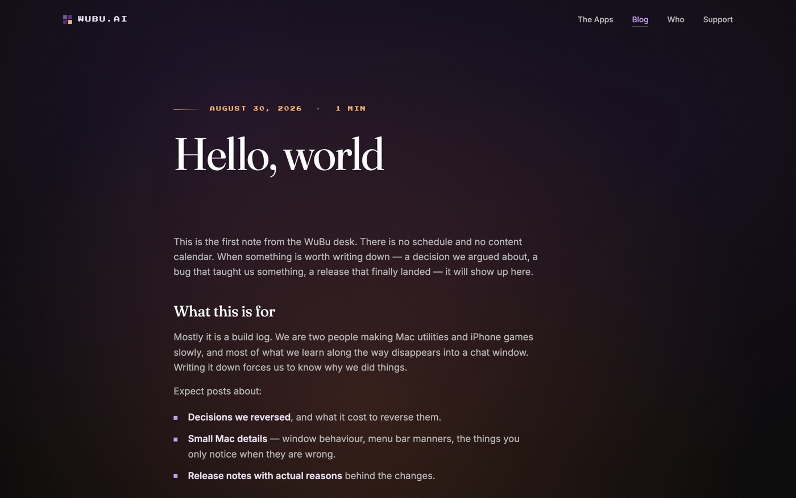

<div align="center">



<p>
  <a href="https://wubu.ai"><b>Visit the site</b></a>
  &nbsp;·&nbsp;
  <a href="https://wubu.ai/blog.html">Read the blog</a>
  &nbsp;·&nbsp;
  <a href="https://wubu.ai/who.html">Who we are</a>
  &nbsp;·&nbsp;
  <a href="https://wubu.ai/support.html">Support</a>
</p>

<p>
  <a href="https://wubu.ai"></a>
  
  
  
</p>

</div>

> **WuBu, LLC** makes Mac utilities and iPhone games, slowly and on purpose.
> This is the website — built the same way: hand-written HTML, nothing to
> install, nothing to compile, no framework to keep up with.

---

## See it

|  |  |
|:--:|:--:|
| <br><sub>**Home** — editorial hero, live clock</sub> | <br><sub>**The moment** — pinned and grown to full bleed on scroll</sub> |
| <br><sub>**Blog** — markdown files, rendered in the browser</sub> | <br><sub>**A post** — one `.md` file, no CMS</sub> |

---

## Why it is built like this

| Nothing to install | One design system | Writing, not tooling |
|---|---|---|
| No node_modules, no bundler, no CI. Clone it, open a file, read the whole thing in an afternoon. | `studio.css` holds the palette, the type and every shared component. Change a custom property, the site follows. | A post is a markdown file with a date in its name. Two commands and it is live. |

---

## Quick start

```sh
git clone https://github.com/barkz/barkz.github.io.git
cd barkz.github.io
python3 -m http.server 8000     # then open http://localhost:8000
```

> [!IMPORTANT]
> Serve it over http — do not open the files directly. The blog `fetch()`es its
> own posts, and browsers block that on `file://` URLs, so the blog looks empty.

## Publish a post

```sh
vi posts/your-topic-2026-09-14.md     # name it topic-YYYY-MM-DD.md
python3 tools/build-blog-index.py     # rebuilds posts/posts.json
git add posts && git commit -m "New post" && git push
```

The date orders the posts and sets the byline. The first `# Heading` is the
title, the first paragraph is the excerpt. Full rules: [posts/README.md](posts/README.md).

<details>
<summary><b>Everything in the repo</b></summary>

<br>

| Path | |
|---|---|
| `index.html` | home — hero, the pinned Clocktastic frame, releases, quiet rules |
| `blog.html` · `post.html` | blog index, and the single-post reader (`?p=slug`) |
| `who.html` · `support.html` · `privacy.html` | interior pages |
| `studio.css` | the design system: palette, type, nav, prose, footer |
| `studio.js` | ambient canvas, nav state, scroll reveals |
| `blog.js` | markdown renderer and blog rendering |
| `posts/` | posts as markdown + the generated `posts.json` |
| `tools/` | `build-blog-index.py` |
| `CNAME` · `.nojekyll` | the domain, and "Pages, hands off the markdown" |

</details>

---

## The palette


Fraunces for display · Inter for text · Press Start 2P for the pixel accents.

<div align="center">
<br>
<sub>© 2026 WuBu, LLC — polished over fast, tools not traps.</sub>
</div>
